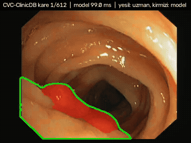
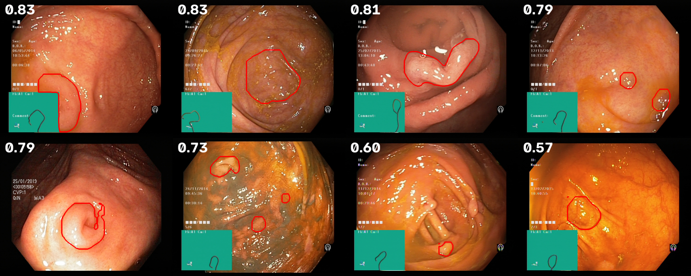
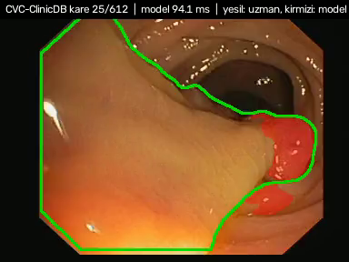

# polip-tespit

Kolonoskopi görüntülerinde polip segmentasyonu ve tespiti. Asıl soru modelin ne kadar iyi
olduğu değil, **başka bir hastanenin verisinde ne kadar iyi kaldığı**: model Kvasir-SEG
(Oslo) ile eğitilir, CVC-ClinicDB (Barselona) ile hiç görmeden test edilir.

Tıbbi cihaz değildir. Araştırma ve öğrenme amaçlıdır.



*CVC-ClinicDB, eğitimde hiç görülmemiş kareler. Yeşil: uzman maskesi, kırmızı: U-Net tahmini.
Tam video: [`docs/demo_cvc.mp4`](docs/demo_cvc.mp4) (FFmpeg ile H.264, 612 kare).*

## Sonuçlar

Eşikler ve model seçimi testten önce sabitlendi (aşağıda protokol). Köşeli parantezler %95
güven aralığıdır (Dice: bootstrap, oranlar: Wilson).

| | U-Net ResNet34 | YOLOv8s-seg |
|---|---|---|
| **Kvasir iç test** (100 görüntü), Dice | **0.919** [0.894, 0.942] | 0.898 [0.871, 0.925] |
| IoU | 0.868 | 0.840 |
| Lezyon duyarlılığı / kesinlik | 0.931 / 0.805 | 0.902 / 0.836 |
| AP50 | 0.907 | 0.857 |
| **CVC-ClinicDB dış test** (612 kare), Dice | 0.851 [0.835, 0.866] | 0.848 [0.831, 0.864] |
| IoU | 0.777 | 0.778 |
| Lezyon duyarlılığı / kesinlik | 0.847 / 0.819 | 0.864 / 0.877 |
| AP50 | 0.822 | 0.843 |
| Görüntü başına yanlış pozitif | 0.20 | 0.13 |
| **Polipsiz kolon** (100), görüntü düzeyi özgüllük | **0.33** [0.25, 0.43] | **0.74** [0.65, 0.82] |
| Görüntü düzeyi ROC-AUC, CVC vs polipsiz | 0.927 | 0.956 |

**Ne söylüyor:**

1. **Başka merkeze geçince iki model de düşüyor, ama aynı yere düşüyor.** İç testte U-Net önde
   (Dice 0.919 vs 0.898; aralıklar örtüşüyor, 100 görüntüde kesin değil), dış testte fark
   tamamen kayboluyor (0.851 vs 0.848). İç testteki üstünlük dış teste taşınmıyor.
2. **Özgüllük iki modelin de zayıf noktası.** Kvasir-SEG'deki 1000 görüntünün hepsinde polip var.
   Modeller eğitimde hiç polipsiz görüntü görmedi, "burada polip yok" demeyi öğrenmedi. U-Net
   polipsiz görüntülerin üçte ikisinde yanlış alarm veriyor. Yanlış alarmlar kabarık kıvrımlar,
   yuvarlak çıkıntılar ve kalıntılı bölgelere düşüyor (aşağıdaki şekil). ROC-AUC'nin 0.93–0.96
   olması, ayrımın skorlarda var olduğunu ama eşiğin polipsiz görüntü için ayarlanmadığını
   gösteriyor. Eşiği bu 100 görüntüye göre ayarlamak test verisine uydurmak olurdu, yapılmadı.
3. **Dış testte kaçırılan poliplerin çoğu "bulunmuş ama sınırı yanlış".** U-Net'in kaçırdığı 99
   polipten 65'inde tahmin polipe değiyor ama kutu IoU 0.5'in altında kalıyor; 34'ü hiç
   bulunamadı. YOLO'da bu oran 43'e 45.



### Hata analizi: polip boyutu

CVC dış testinde lezyon duyarlılığı, polip alanına göre (kutu IoU ≥ 0.5):

| Polip alanı / görüntü | n | U-Net | YOLOv8s-seg |
|---|---|---|---|
| < %1 | 35 | **0.46** | **0.57** |
| %1–3 | 124 | 0.84 | 0.85 |
| %3–10 | 279 | 0.90 | 0.90 |
| > %10 | 208 | 0.84 | 0.87 |

Küçük polipler belirgin biçimde kötü. Kvasir iç testinde %1'in altında hiç polip yok, yani bu
zayıflık iç testte görünmüyordu; ancak dış testte ortaya çıktı. Büyük poliplerde de hafif düşüş
var ve neredeyse tamamı polipin yalnızca bir kısmının işaretlendiği durumlar: U-Net'in kaçırdığı
33 büyük polipten 29'unda tahmin polipe değiyor (YOLO: 28'de 18).



**Elenen hipotez:** kaçırmaların parlamadan (speküler yansıma) kaynaklandığını düşündüm.
Polip içindeki parlama oranı kaçırılanlarda da yakalananlarda da medyan ~0 (U-Net:
0.000 vs 0.001). Veri bunu desteklemiyor.

Şekiller: [`docs/unet_r34/`](docs/unet_r34/), [`docs/yolov8s_seg/`](docs/yolov8s_seg/).
Görüntü ve polip başına ham sonuçlar: `results/<model>/*.csv`.

### Çıkarım hızı (RTX 2080, 352×352, batch 1)

| Yol | Medyan | FPS |
|---|---|---|
| PyTorch FP32, CUDA | 17.1 ms | 58 |
| PyTorch FP16 (autocast), CUDA | 11.9 ms | 84 |
| ONNX Runtime, CPU | 94.5 ms | 11 |

ONNX çıktısı PyTorch ile karşılaştırıldı: 50 dış test karesinde en büyük olasılık farkı
1.9×10⁻⁵, maske Dice'ı 1.0. ONNX Runtime'ın CUDA ve TensorRT sağlayıcıları ölçülemedi:
`onnxruntime-gpu` 1.23 CUDA 12 kütüphaneleri istiyor, bu makinedeki PyTorch ise CUDA 13 ile
geliyor. Betik ([`scripts/export_onnx.py`](scripts/export_onnx.py)) istenen sağlayıcı
yüklenemeyip CPU'ya düşerse bunu ölçüm diye raporlamaz, hata olarak yazar.

## Sınırlar

- Özgüllük 100 polipsiz görüntüyle ölçüldü, aralık geniş. Bu görüntüler Kvasir ile aynı
  merkezden; dış merkezde özgüllük ölçülmedi.
- CVC-ClinicDB'nin 612 karesi 29 videodan geliyor, ardışık kareler bağımsız değil. Güven
  aralıkları bu yüzden olduğundan dar görünebilir.
- Tek tohumla tek eğitim; tohumlar arası değişkenlik ölçülmedi.
- Sıradaki adım belli: eğitime polipsiz görüntü eklemek ve eşiği ayrı bir negatif doğrulama
  setiyle seçmek.

## Veri

| Veri seti | Kullanım | Görüntü | Kaynak |
|---|---|---|---|
| Kvasir-SEG | eğitim 800 / doğrulama 100 / iç test 100 | 1000, 333 farklı çözünürlük | [Simula](https://datasets.simula.no/kvasir-seg/) |
| CVC-ClinicDB | yalnızca dış test | 612 kare, 29 video, 384×288 | [polyp.grand-challenge.org](https://polyp.grand-challenge.org/CVCClinicDB/) (HF dosya aynası) |
| Kvasir v2 `normal-cecum` | yalnızca özgüllük testi (polipsiz) | 100 | Kvasir v2 (HF aynası, sınıf başına 100'lük alt küme) |

Bölme sabit tohumla bir kez üretilip [`splits/kvasir_split.json`](splits/kvasir_split.json)
dosyasına yazıldı. İki veri setinde polipler farklı büyüklükte: Kvasir'de polip, görüntünün
medyan %11.4'ünü kaplıyor, CVC'de %6.8'ini.

## Değerlendirme protokolü

Testten önce sabitlendi, sonradan değiştirilmedi:

- Model seçimi yalnızca Kvasir doğrulama Dice'ı ile (60 epoch içindeki en iyi epoch).
- Eşikler sabit: U-Net olasılığı 0.5, YOLO güveni 0.25 (Ultralytics varsayılanı). Testte ayar yok.
- CVC-ClinicDB ve polipsiz görüntüler eğitim, model seçimi ya da eşik için hiç kullanılmadı.
- Metrikler özgün çözünürlükte hesaplanır (tahmin 352×352'den geri büyütülür).

Metrikler ([`src/polip/metrics.py`](src/polip/metrics.py), birim testli):

- **Segmentasyon:** görüntü başına Dice ve IoU, ortalama + bootstrap %95 güven aralığı.
- **Lezyon düzeyi tespit:** tahmin maskesinin her bağlantılı bileşeni bir tespittir (50 pikselden
  küçükler atılır), skoru bileşen içindeki ortalama olasılıktır. Kutu IoU ≥ 0.5 ile eşleşen tespit
  doğrudur. Buradan duyarlılık, kesinlik, görüntü başına yanlış pozitif ve AP50.
- **Görüntü düzeyi:** görüntüde en az bir tespit varsa "polip var". Polipli setlerde duyarlılık,
  polipsiz sette özgüllük (Wilson %95 aralığı) ve ROC-AUC.

## Modeller

- **U-Net + ResNet34** (ImageNet ön-eğitimli kodlayıcı, `segmentation-models-pytorch`): BCE + Dice
  kaybı, AdamW, OneCycle, karışık hassasiyet, 352×352 girdi, döndürme/ölçek/renk artırması.
- **YOLOv8s-seg** (COCO ön-eğitimli): aynı bölme, örnek segmentasyonu; örnek maskeleri aynı
  değerlendirme kodundan geçsin diye tek bir haritaya indirgenir.

## Çalıştırma

```bash
python -m venv .venv && .venv/Scripts/activate      # Linux: source .venv/bin/activate
pip install -e .[dev]
python scripts/download_data.py                     # ~128 MB
python scripts/train.py --epochs 60                 # U-Net, RTX 2080'de ~75 dk
python scripts/yolo_prepare.py && python scripts/train_yolo.py
python scripts/evaluate.py --ckpt checkpoints/unet_r34/best.pt --tag unet_r34
python scripts/evaluate.py --yolo checkpoints/yolov8s_seg/weights/best.pt --tag yolov8s_seg
python scripts/error_analysis.py --ckpt checkpoints/unet_r34/best.pt --tag unet_r34
python scripts/export_onnx.py --ckpt checkpoints/unet_r34/best.pt
python scripts/make_demo_video.py --onnx checkpoints/unet_r34/model.onnx
pytest
```

## Atıf ve lisans

Kod MIT lisanslıdır. Veri setleri bu repoda bulunmaz; `docs/` altındaki kareler ve şekiller
yalnızca sonuçları göstermek için kullanılan türev görüntülerdir ve veri setlerinin kendi
koşullarına tabidir (araştırma/eğitim amaçlı kullanım, atıf zorunlu):

- Jha D. ve ark., *Kvasir-SEG: A Segmented Polyp Dataset*, MMM 2020.
- Bernal J. ve ark., *WM-DOVA maps for accurate polyp highlighting in colonoscopy: Validation vs. saliency maps from physicians*, Computerized Medical Imaging and Graphics, 2015 (CVC-ClinicDB).
- Pogorelov K. ve ark., *Kvasir: A Multi-Class Image Dataset for Computer Aided Gastrointestinal Disease Detection*, MMSys 2017.
